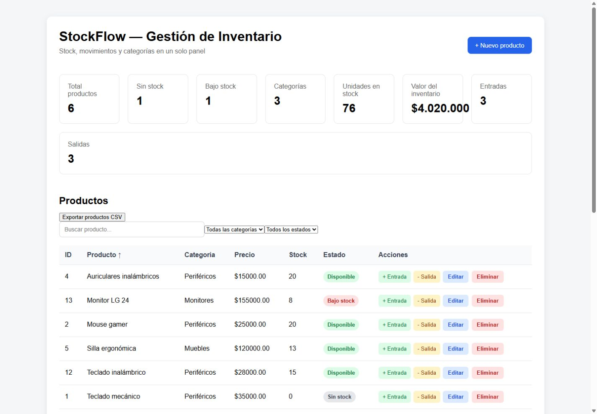
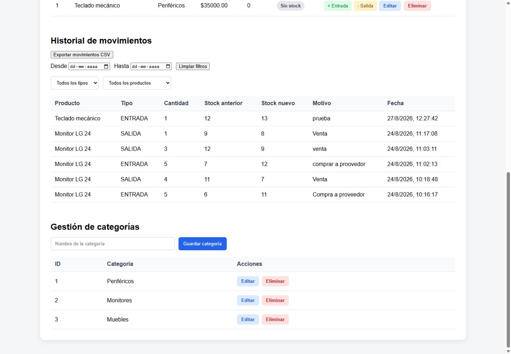
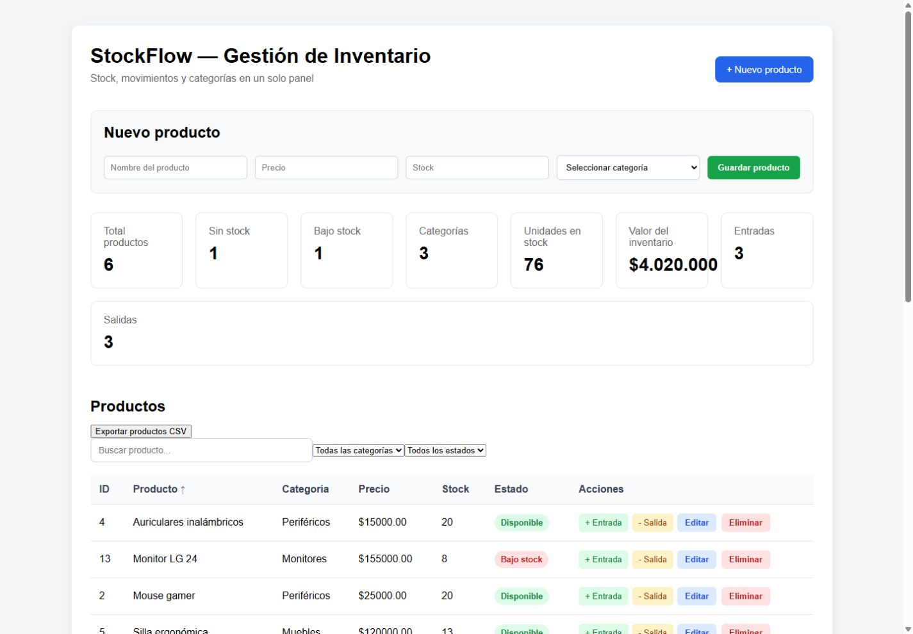
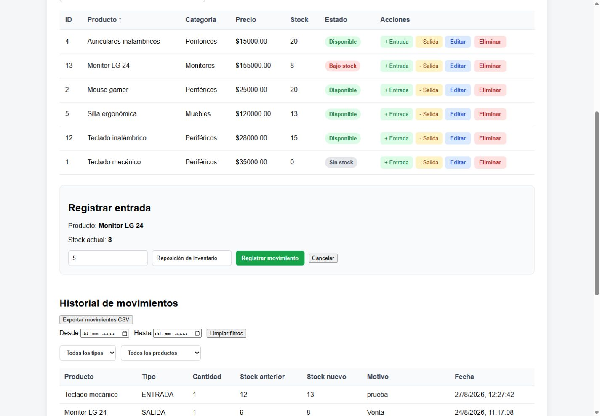
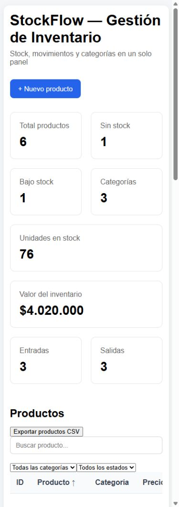

# StockFlow — Gestión de inventario

StockFlow es una aplicación web de portafolio para administrar productos y controlar su stock. Permite registrar entradas y salidas, consultar el historial y ver un resumen del inventario desde un mismo panel.

## Capturas

**Dashboard y productos**



**Historial de movimientos y categorías**



**Creación de productos**



**Registro de movimientos**



<details>
<summary>Ver la versión móvil</summary>



</details>

## Funcionalidades

- Creación, edición y eliminación de productos y categorías.
- Entradas y salidas con cantidad, motivo y fecha, con validación para evitar stock negativo.
- Dashboard con totales, valor del inventario y alertas de stock bajo o agotado.
- Búsqueda, ordenamiento, filtros por categoría, estado y fecha, y exportación CSV.
- Interfaz adaptable a pantallas pequeñas y mensajes de error en los formularios.

## Tecnologías y funcionamiento

El frontend usa **React, TypeScript y Vite**. Se comunica con una API REST construida con **Node.js y Express**, que guarda la información en **MySQL**.

Al registrar un movimiento, el backend actualiza el stock y guarda su historial dentro de una transacción. Si una operación falla, se revierten los cambios. También bloquea la fila del producto durante la operación para evitar inconsistencias cuando llegan movimientos simultáneos.

## Cómo ejecutarlo

Requisitos: **Node.js 24**, **npm** y **MySQL 8** iniciado.

1. En una instalación nueva, importa `database/stockflow.sql` con tu cliente MySQL para crear la base y sus tablas.
2. Copia `backend/.env.example` a `backend/.env` y configura los datos de conexión a MySQL.
3. Copia `frontend/.env.example` a `frontend/.env`. Por defecto, la API usa el puerto 3000.
4. Desde la raíz del proyecto, abre dos terminales y ejecuta:

**Terminal 1 — backend:**

```powershell
cd backend
npm ci
npm run dev
```

**Terminal 2 — frontend:**

```powershell
cd frontend
npm ci
npm run dev
```

Abre [http://localhost:5173](http://localhost:5173). Crea primero una categoría y después un producto. Mantén ambas terminales abiertas mientras usas la aplicación; para detenerla, presiona `Ctrl + C` en cada una.

Si usas otro puerto para el frontend, ajusta `CORS_ORIGIN` en `backend/.env`. Los archivos `.env` contienen configuración local y están excluidos de Git.

## Pruebas

| Carpeta | Comando | Qué comprueba |
| --- | --- | --- |
| `frontend` | `npm test` | Estados de stock, validaciones, mensajes de API y exportación CSV. |
| `frontend` | `npm run lint` | Reglas de calidad del código. |
| `backend` | `npm test` | Confirmación y reversión de transacciones, stock insuficiente y cantidades inválidas. |
| `backend` | `npm run test:integration` | Operaciones de la API contra MySQL, incluidos movimientos simultáneos. |

La prueba de integración crea y elimina una base temporal; requiere permisos para crear bases de datos. Para compilar, ejecuta `npm run build` dentro de cada carpeta.

## Alcance

Proyecto de portafolio orientado a demostrar desarrollo full stack, modelado relacional y manejo de inventario. La versión actual no incluye autenticación ni roles de usuario.
